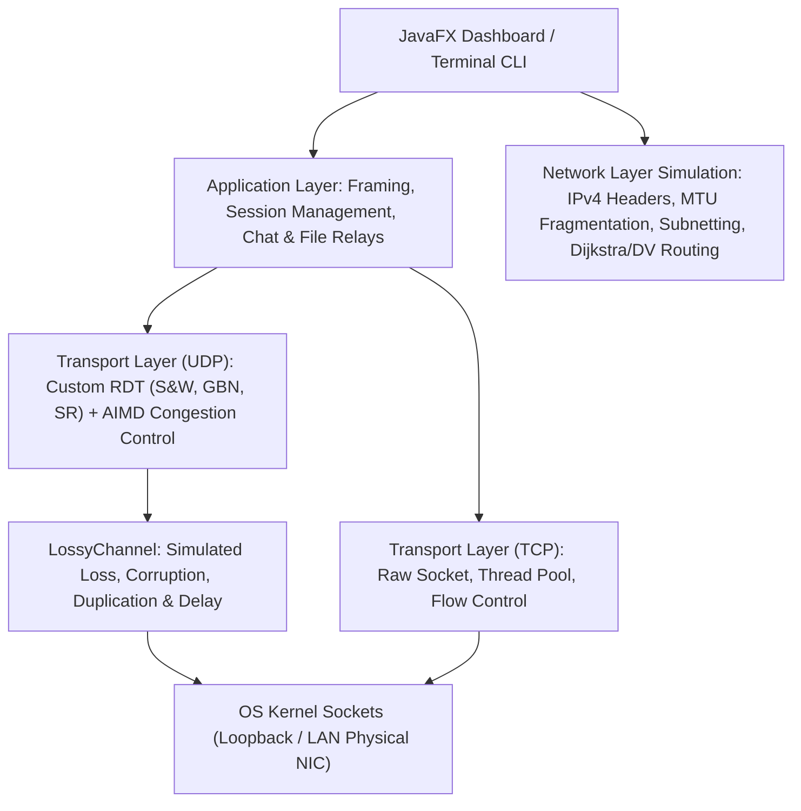
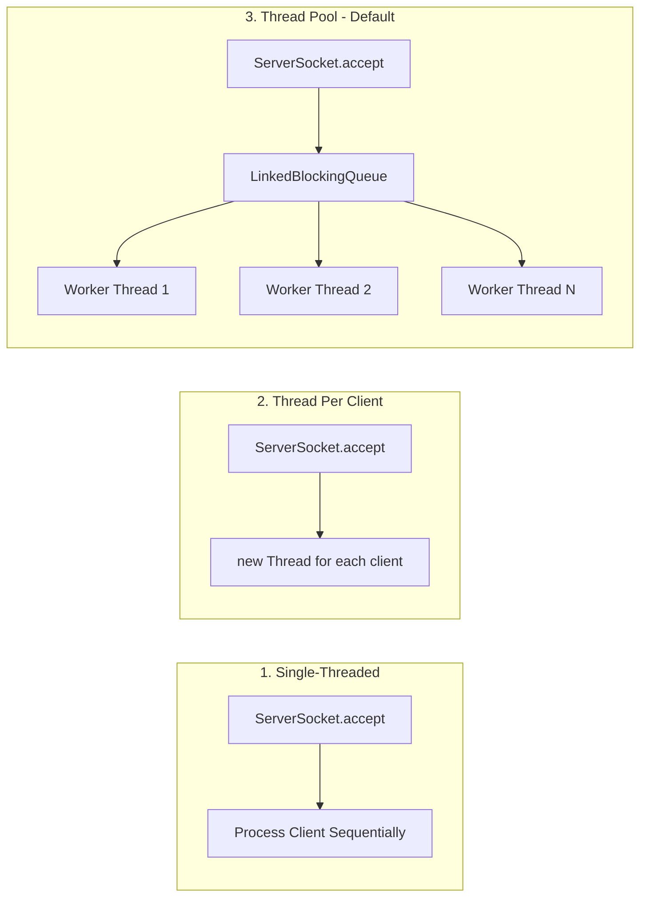
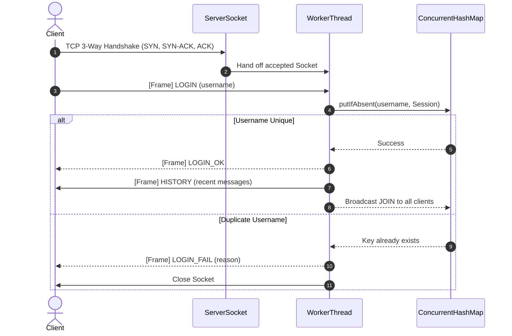
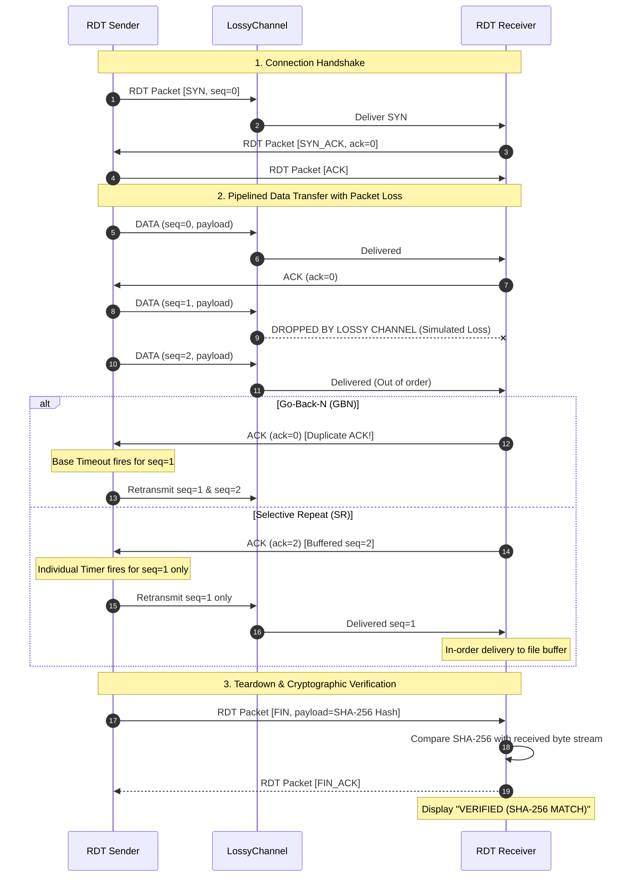

# MeshTalk System Architecture

## 1. High-Level Layered Architecture

MeshTalk maps directly to the classical ISO/OSI and TCP/IP protocol stacks, demonstrating how modern network protocols operate from raw sockets up to the application interface.

---

## 2. Server Concurrency Models

MeshTalk implements three distinct server concurrency architectures to measure performance and resource limits:

---

## 3. TCP Connection & Authentication Sequence

---

## 4. Reliable Data Transfer (RDT) over UDP Sequence

---

## 5. Threading and State Safety

- **Session Registry**: `ConcurrentHashMap<String, ClientSession>` ensures $O(1)$ lock-free reads during broadcast, with thread-safe atomic put/delete operations.
- **Atomic Counters**: All metrics (`connectedClients`, `totalMessages`, `totalBytes`, `activeThreads`) use `java.util.concurrent.atomic.AtomicLong` and `AtomicInteger` for lock-free hardware CAS operations.
- **FrameWriter**: Synchronizes internally on the socket's `DataOutputStream` monitor lock, preventing frame corruption when multiple background threads write to the same client simultaneously.
- **Heartbeat Reaper**: A dedicated daemon thread scans online sessions every 5 seconds and purges sockets that have been silent for more than 15 seconds.
