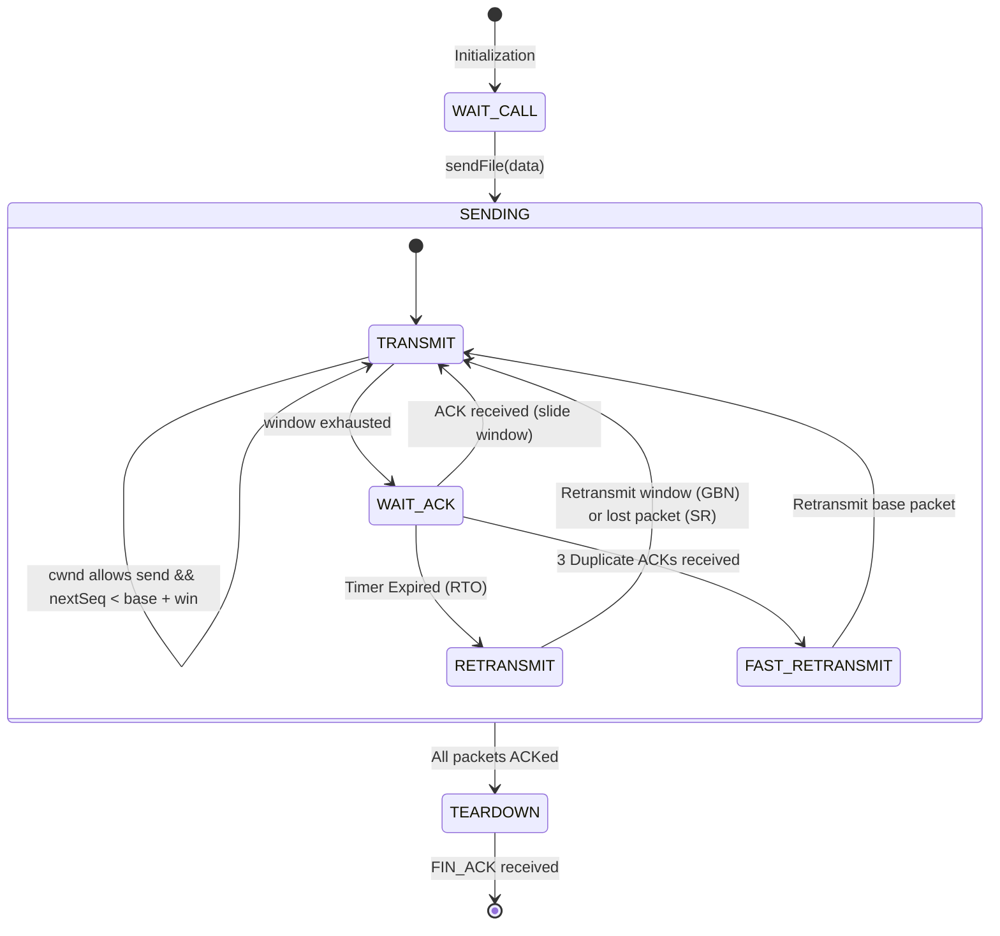

# MeshTalk Protocol Specification

## 1. Application-Layer Protocol (Over TCP)

### 1.1 Wire Framing Format
TCP provides a raw continuous byte stream with no intrinsic record or message boundaries. MeshTalk enforces message demarcation using a **length-prefixed framing format**:

```
 0                   1                   2                   3
 0 1 2 3 4 5 6 7 8 9 0 1 2 3 4 5 6 7 8 9 0 1 2 3 4 5 6 7 8 9 0 1
+-+-+-+-+-+-+-+-+-+-+-+-+-+-+-+-+-+-+-+-+-+-+-+-+-+-+-+-+-+-+-+-+
|                 Length (32-bit unsigned int)                  |
+-+-+-+-+-+-+-+-+-+-+-+-+-+-+-+-+-+-+-+-+-+-+-+-+-+-+-+-+-+-+-+-+
|   Type (1B)   |          Payload Bytes (Length - 1)           |
+-+-+-+-+-+-+-+-+                                               |
|                             ...                               |
+-+-+-+-+-+-+-+-+-+-+-+-+-+-+-+-+-+-+-+-+-+-+-+-+-+-+-+-+-+-+-+-+
```

- **Length (4 bytes, Big-Endian):** Total number of bytes following the length field (equal to `1 + payload.length`).
- **Type (1 byte):** Protocol message opcode from the table below.
- **Payload:** Variable-length payload (UTF-8 encoded string or binary chunk).

Safe frame reading is guaranteed via `java.io.DataInputStream.readFully()`, eliminating truncation from partial TCP segment reads. Frames with `length > 10MB` or `length < 1` are rejected to prevent buffer overflow denial-of-service.

---

### 1.2 Protocol Message Types

| Opcode | Enum Name | Direction | Payload Structure | Description |
|---|---|---|---|---|
| `0x01` | `LOGIN` | Client → Server | `username` | Requests login with requested unique username |
| `0x02` | `LOGIN_OK` | Server → Client | `welcome message` | Acknowledges successful authentication |
| `0x03` | `LOGIN_FAIL` | Server → Client | `rejection reason` | Rejection notice (duplicate or invalid name) |
| `0x04` | `LOGOUT` | Client → Server | *(none)* | Clean graceful disconnection request |
| `0x05` | `PING` | Bidirectional | *(none)* | Keep-alive heartbeat query |
| `0x06` | `PONG` | Bidirectional | *(none)* | Response to keep-alive heartbeat query |
| `0x10` | `MSG` | Client → Server | `text` | Public broadcast message |
| `0x11` | `MSG_RELAY` | Server → Client | `sender\0text` | Broadcast message relay with sender identity |
| `0x12` | `PRIVATE` | Client → Server | `target\0text` | Private unicast message to target user |
| `0x13` | `PRIVATE_RELAY`| Server → Client | `sender\0text` | Relayed private message |
| `0x14` | `USERS` | Client ↔ Server | `user1,user2,...` | Request / CSV list of currently online users |
| `0x15` | `JOIN` | Server → Client | `username` | Notification of a newly joined user |
| `0x16` | `LEAVE` | Server → Client | `username` | Notification of a user disconnection |
| `0x17` | `HISTORY` | Server → Client | `msg1\nmsg2...` | Last $N$ broadcast chat history entries |
| `0x20` | `FILE_OFFER` | Client → Server | `target\0file\0size`| Informs server of file transfer intention |
| `0x21` | `FILE_ACCEPT` | Server → Client | `sender\0file\0size`| Relays file offer to the recipient |
| `0x22` | `FILE_CHUNK` | Bidirectional | `[raw binary bytes]` | 4096-byte sliced binary file chunk |
| `0x23` | `FILE_END` | Client → Server | `sha256Hex` | Indicates end of file stream with SHA-256 hash |
| `0x24` | `FILE_ACK` | Client ↔ Server | `status` | Reports verification outcome (`VERIFIED`/`FAILED`) |
| `0x30` | `ERROR` | Server → Client | `error description` | Notifies client of protocol or permission errors |
| `0x31` | `ACK` | Bidirectional | `status text` | Generic acknowledgement response |

---

## 2. Reliable Data Transfer (RDT) Protocol (Over UDP)

### 2.1 Packet Header Specification (17 Bytes)

```
 0                   1                   2                   3
 0 1 2 3 4 5 6 7 8 9 0 1 2 3 4 5 6 7 8 9 0 1 2 3 4 5 6 7 8 9 0 1
+-+-+-+-+-+-+-+-+-+-+-+-+-+-+-+-+-+-+-+-+-+-+-+-+-+-+-+-+-+-+-+-+
|   Type (1B)   |            Sequence Number (32-bit)           |
+-+-+-+-+-+-+-+-+-+-+-+-+-+-+-+-+-+-+-+-+-+-+-+-+-+-+-+-+-+-+-+-+
|    ... (cont) |            Acknowledgement Number (32-bit)    |
+-+-+-+-+-+-+-+-+-+-+-+-+-+-+-+-+-+-+-+-+-+-+-+-+-+-+-+-+-+-+-+-+
|    ... (cont) |  Window Size (16-bit) |  Length (16-bit)      |
+-+-+-+-+-+-+-+-+-+-+-+-+-+-+-+-+-+-+-+-+-+-+-+-+-+-+-+-+-+-+-+-+
|                         CRC32 Checksum (32-bit)               |
+-+-+-+-+-+-+-+-+-+-+-+-+-+-+-+-+-+-+-+-+-+-+-+-+-+-+-+-+-+-+-+-+
|                       Payload Data (...)                      |
+-+-+-+-+-+-+-+-+-+-+-+-+-+-+-+-+-+-+-+-+-+-+-+-+-+-+-+-+-+-+-+-+
```

- **Type (1 Byte):**
  - `0x01` = `DATA`
  - `0x02` = `ACK`
  - `0x03` = `SYN`
  - `0x04` = `SYN_ACK`
  - `0x05` = `FIN`
  - `0x06` = `FIN_ACK`
  - `0x07` = `NACK`
- **Sequence Number (4 Bytes):** 32-bit packet sequence number.
- **Acknowledgement Number (4 Bytes):** 32-bit cumulative (GBN) or selective (SR) ACK number.
- **Window Size (2 Bytes):** Receiver-advertised flow-control window (packets).
- **Length (2 Bytes):** Payload length in bytes (max 1024 bytes per datagram).
- **CRC32 Checksum (4 Bytes):** CRC32 computed across `Type || SeqNo || AckNo || WindowSize || Length || Payload`.

---

### 2.2 Sender State Machine (Go-Back-N & Selective Repeat)



---

### 2.3 TCP Congestion Control State Machine (Tahoe & Reno)

```mermaid
stateDiagram-v2
    [*] --> SLOW_START: cwnd = 1, ssthresh = 64
    
    state SLOW_START {
        note right of SLOW_START: cwnd doubles every RTT (cwnd += 1 per ACK)
    }
    
    SLOW_START --> CONGESTION_AVOIDANCE: cwnd >= ssthresh
    SLOW_START --> SLOW_START: Timeout: ssthresh = cwnd/2, cwnd = 1
    
    state CONGESTION_AVOIDANCE {
        note right of CONGESTION_AVOIDANCE: Linear growth (AIMD: cwnd += 1/cwnd per ACK)
    }
    
    CONGESTION_AVOIDANCE --> SLOW_START: Timeout: ssthresh = cwnd/2, cwnd = 1
    
    CONGESTION_AVOIDANCE --> FAST_RECOVERY: 3 Duplicate ACKs (Reno)
    FAST_RECOVERY --> CONGESTION_AVOIDANCE: New ACK arrived (cwnd = ssthresh)
    FAST_RECOVERY --> SLOW_START: Timeout in Fast Recovery
    
    CONGESTION_AVOIDANCE --> SLOW_START: 3 Duplicate ACKs (Tahoe: cwnd = 1)
```

---

### 2.4 Adaptive RTO Calculations (RFC 6298)
MeshTalk computes retransmission timers using exponential moving averages:

$$\text{EstimatedRTT} = (1 - \alpha) \cdot \text{EstimatedRTT} + \alpha \cdot \text{SampleRTT}$$
$$\text{DevRTT} = (1 - \beta) \cdot \text{DevRTT} + \beta \cdot |\text{SampleRTT} - \text{EstimatedRTT}|$$
$$\text{RTO} = \text{EstimatedRTT} + 4 \cdot \text{DevRTT}$$

Where $\alpha = 0.125$, $\beta = 0.25$, bounded between $\text{MIN\_RTO} = 200\text{ ms}$ and $\text{MAX\_RTO} = 10000\text{ ms}$. Karn's algorithm is enforced: retransmitted packets are never sampled for RTT, and timeouts double the RTO (exponential backoff).
